# XIN Power 数控可调电源

复刻与使用说明　V2硬件 / 固件6.2.3　更新于2026年10月14日

XIN Power是我在原开源电源方案基础上开发的一款便携式数控电源，主要用于单片机、小电路和模块调试。我采用PY32F403主控、SC8701四开关升降压功率级和2.4英寸电容触摸屏，实现了本机调压、有线/蓝牙上位机、16点电压校准和在线升级。这份说明整理了我使用的硬件配置、装配方法和实测结果，方便大家复刻和继续开发。

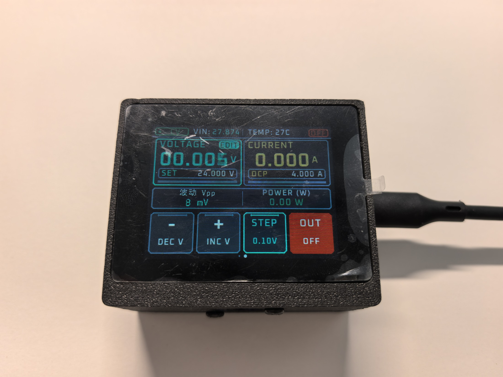

实物主界面。照片中输出关闭，24V为设定值

| 参数 | 当前配置 |
| --- | --- |
| 输出电压 | **3.2～32V** |
| 电流设置 | **0.1～8A过流关断阈值**，超限关闭并锁存 |
| 屏幕 | 2.4英寸，240×320，ST7789，SPI，电容触摸 |
| 输入 / 输出接口 | Type-C PD或DC输入；XT30输出；独立Type-C通信口 |
| 测量与回传 | 双INA226；采样500Hz，屏幕50Hz，默认遥测25Hz |
| 工程入口 | [源码仓库](https://github.com/LDO75/XIN_Power)　[固件与上位机](https://github.com/LDO75/XIN_Power/tree/main/downloads) |

**8A是过流阈值设置上限，不代表全电压范围持续输出8A。当前版本不提供恒流输出。** 可用输出功率由输入电源、4.8A输入保护、转换损耗及散热条件共同决定。我在第8节记录了三个负载工作点，以及约95W连续运行20分钟、板上NTC稳定在69℃的测试结果。

## 01 硬件结构与关键配置

我采用控制板、功率板和打印外壳的组合结构。两块PCB通过2×5排针/排母连接，传递供电、I²C、使能和温度信号。

```text
功率：PD / DC输入 → 输入隔离 → SC8701升降压 → INA226 → XT30
调压：PY32 → MCP4725 → LMV321 → SC8701 FB
测量：输入 / 输出INA226与NTC → PY32保护判断
交互：触摸屏 / USB串口 / 蓝牙串口 ↔ PY32
存储：PY32 ↔ W25Q256
```

| 模块 | 器件或实现 | 用途 |
| --- | --- | --- |
| 主控 | PY32F403C1DT6 | 界面、校准、保护与通信 |
| 升降压 | SC8701 + 四开关MOS + 6.8µH电感 | 功率变换 |
| 电压设定 | REF3030 + MCP4725 + LMV321 | 3V参考、12位DAC、FB注入 |
| 测量 | 输入/输出各一颗INA226 | 电压、电流和功率 |
| 存储 | W25Q256 | 设置、校准及升级镜像 |
| 通信 | CH340N / VG6328A | USB串口 / 蓝牙串口 |
| 散热控制 | 10kΩ NTC + 12V风扇 | 温度监测与风扇启停 |

### 原理图与实装配置

[功率原理图](../hardware/SCH_XIN_Power功率部分_2026-10-11.pdf)与[控制原理图](../hardware/SCH_XIN_Power控制部分_2026-09-24.pdf)已放在仓库hardware目录。我在新版功率图中保留了两路输入隔离，输出端直接接到输出测量与XT30，删除了输出理想二极管。

**我这块实物的R316为4.99kΩ，与6.2.3固件一致。功率PDF中仍标7.5kΩ，这处标注我还需要修改；复刻时请按4.99kΩ安装。** 其余关键配置如下表。

| 位置 | 6.2.3固件对应配置 |
| --- | --- |
| R274 / R314 / R315 | 100kΩ / 7.5kΩ / 120Ω |
| R316 / R317 | **4.99kΩ / 120Ω**，注入电阻合计5.11kΩ |
| R292 | **1.8kΩ**，输出泄放 |
| INA226分流 | R338、R339均为5mΩ；不要与功率级10mΩ电阻混淆 |
| 输出通路 | 新图已删除输出理想二极管；旧板须旁路其MOS D/S |

输出关闭由SC8701使能控制。**输出端没有独立隔离开关，也不再具有原输出理想二极管的防倒灌能力。** 不要直接接另一个带电电源或电池。

## 02 选料与购买参考

下面是我购买并使用的配件规格与链接。复刻时请先核对型号、尺寸和接口，再选择对应商品选项；同一链接可能包含多个规格。PCB器件按原理图采购，完整BOM我会继续补充。

| 部件 | 已选规格 | 购买参考 |
| --- | --- | --- |
| 屏幕 | 2.4英寸；240×320；ST7789；SPI；10P；带电容触摸 | [屏幕](https://item.taobao.com/item.htm?id=837804675879) |
| 大散热片 | 40×40×8mm，黑色铝制，不带胶 | [散热片](https://item.taobao.com/item.htm?id=692398063178) |
| 小散热片 | 20×20×6mm，带导热贴 | [小散热片](https://item.taobao.com/item.htm?id=770861368176) |
| 风扇 | 2006，12V，订单标注10000转、液压轴承 | [12V风扇](https://item.taobao.com/item.htm?id=709236620296) |
| 导热垫 | 40×40×2.5mm，需按贴合位置裁切 | [导热垫](https://detail.tmall.com/item.htm?id=691608631168) |
| 螺丝 | 黑色十字圆头自攻：M3×5、M3×16 | [螺丝](https://detail.tmall.com/item.htm?id=534923831046) |
| 打印外壳 | 上壳、下壳、压片各一份STEP | 外壳模型目录 |

### 屏幕与排线

屏幕商品分辨率为240×320，固件横屏绘制为320×240。显示与触摸使用独立FPC连接，触摸驱动为CST836U。**同为ST7789的屏幕也要核对排线定义、接点方向与触摸芯片。** 插拔排线前断电，打开锁扣后再插入。

| 显示10P信号 | 触摸6P信号 |
| --- | --- |
| 1 GND　2 DC　3 CS　4 SCK　5 MOSI | 1 3.3V　2 SCL　3 SDA |
| 6 RST　7/8 3.3V　9 LEDA　10 LEDK | 4 INT　5 RST　6 GND |

以上针脚按我上传的控制原理图编号，FPC连接器外壳固定脚不计入信号数量。

### 输入电源

调试时我使用28V输入。采用PD 28V时，充电器、线材及诱骗配置都要支持该档位。我在新版功率图中标出的PD3.1配置为CH224A、R277/R278=0Ω、R279=210kΩ；CH224K配置不能直接当成28V方案。

高功率测试优先使用能持续供电的输入源；有些PD电源会在长时间空载时休眠。USB通信口用于连接电脑，与功率Type-C输入口区分。

## 03 散热安装与外壳装配

我使用功率板元件面的小散热片、底面大散热片和12V风扇散热，下面是实物安装位置。复刻时可按以下顺序检查和装配。

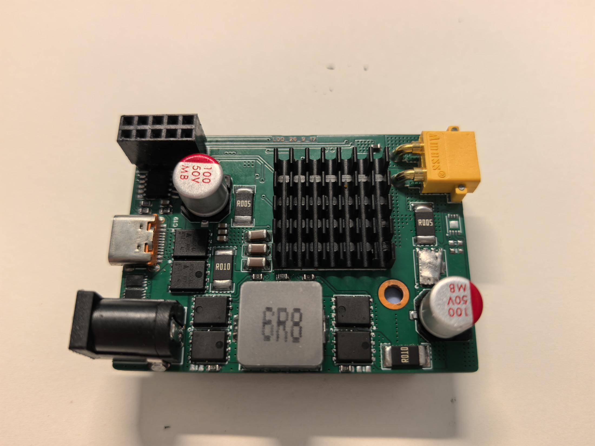

功率板元件面的小散热片

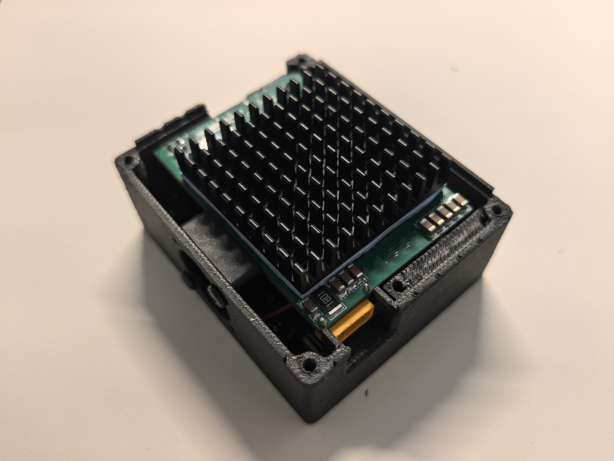

底面大散热片与导热垫的实物安装

### 散热件安装

- 先完成裸板检查、烧录和空载校准，再安装散热片。检查散热片边缘与电容、排针和端子之间的间距。

- 小散热片按实物贴在功率板对应发热区域。大散热片通过导热垫与功率板底面贴合；导热垫须覆盖接触区域，避免铝片碰到裸露焊点。

- 2.5mm是购买的导热垫厚度，不等于所有器件所需间隙。以实际叠层试装为准，不能通过拧紧外壳强压PCB或屏幕。

- 风扇接控制板FAN接口，电源为12V。确认极性并留出叶片间隙，走线避开风道与排针。

**固件默认40℃启动风扇、35℃停止，NTC读数无效时全速运行。** 测试时同时核对实际转动和温度读数。

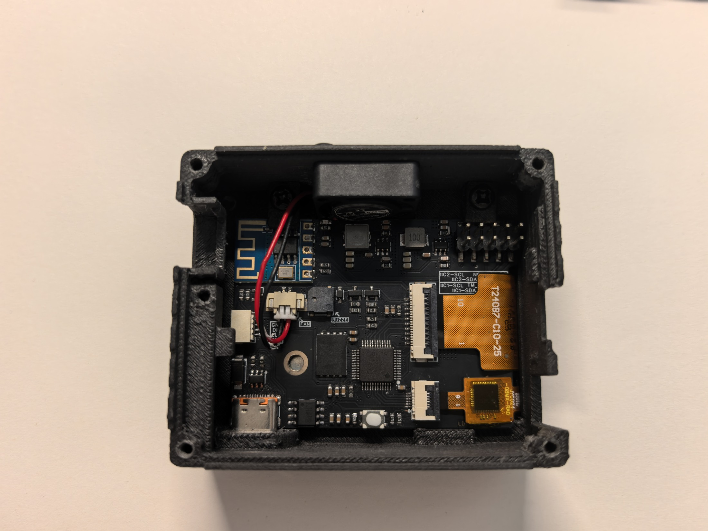

控制板安装、显示/触摸排线和风扇走线

## 04 外壳与接口位置

我制作了三份外壳模型：[上壳](../hardware/enclosure/XIN_Power外壳上.step)、[下壳](../hardware/enclosure/XIN_Power外壳下.step)、[压片](../hardware/enclosure/XIN_Power外壳压片.step)。STEP适合尺寸核对和修改，导入切片软件后生成打印文件。

打印材料：**ABS-CF10**。我按材料预设的默认参数打印了这套外壳，层高、壁数、填充率及温度设置会随切片工程补充。

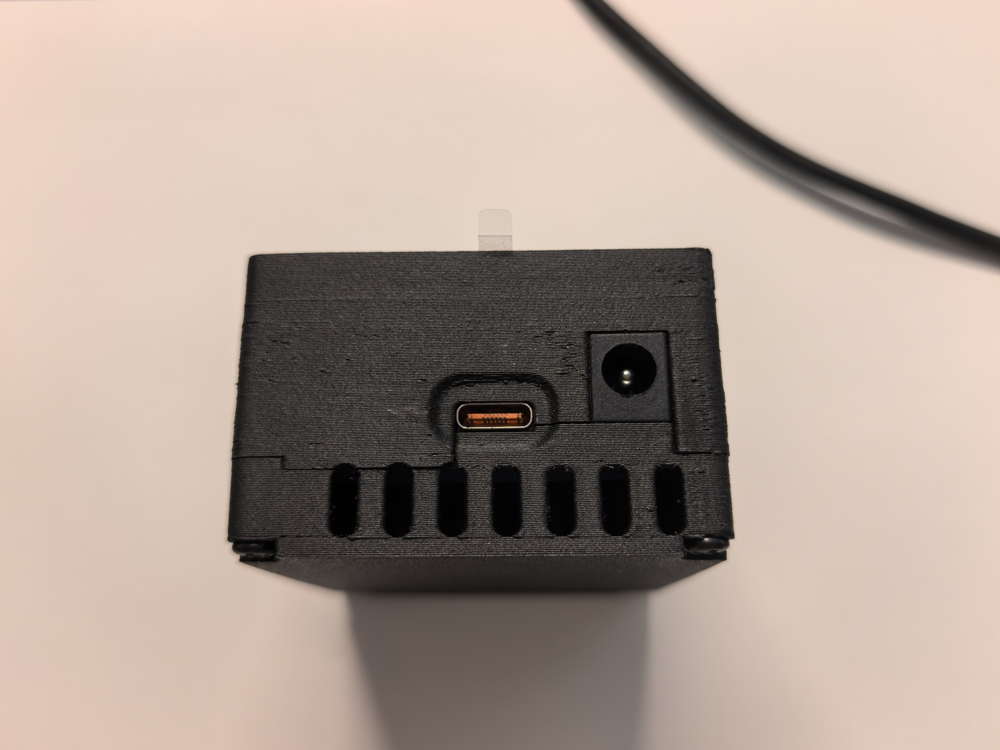

功率输入面：Type-C与DC插座

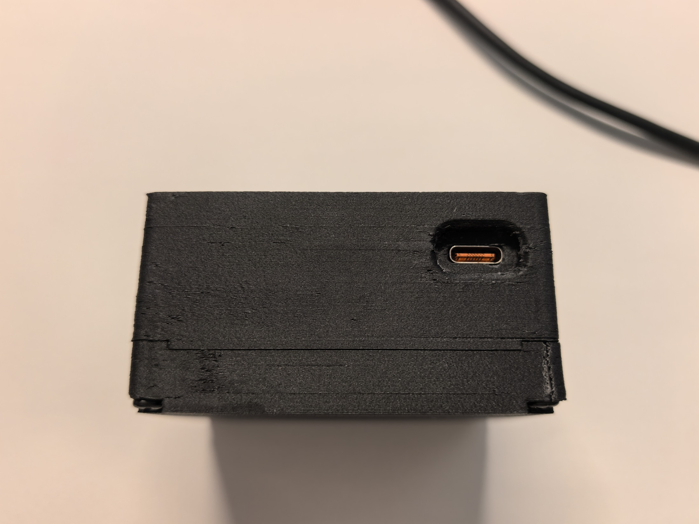

控制板侧的Type-C通信接口

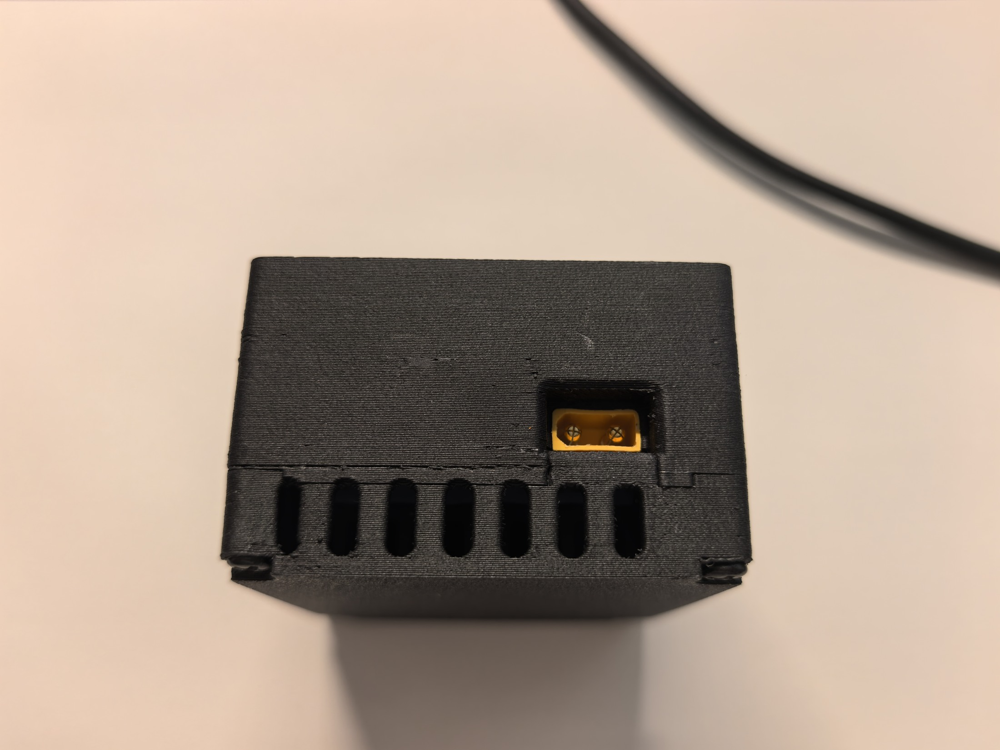

XT30输出与通风开孔

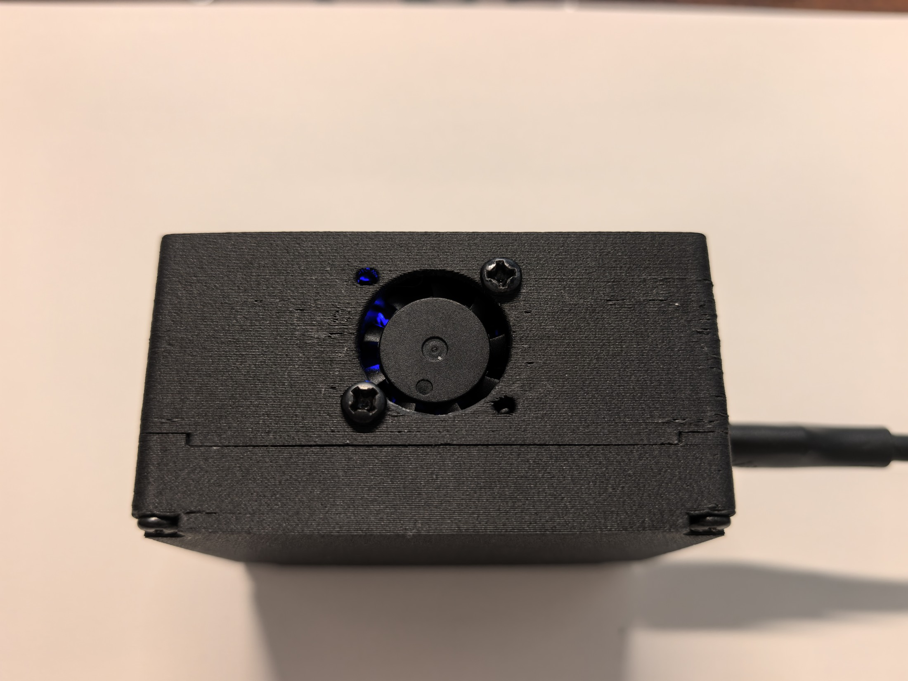

侧面风扇与固定位置

### 装配顺序

- 试装上壳、下壳和压片，确认屏幕窗口、接口开孔和螺柱位置；清理影响配合的毛边。

- 固定屏幕与控制板，接好两条FPC；按图连接风扇并整理走线。

- 检查2×5排针方向和针脚顺序，将功率板与控制板对接。安装导热垫与散热片后，再合壳。

- M3×5和M3×16按实际孔位选用，记录最终数量与用途。用自攻螺丝锁紧打印件时，避免过深触碰板件。

## 05 烧录与首次上电

### 工程与下载入口

| 目录 / 文件 | 用途 |
| --- | --- |
| firmware/current/01_Bootloader | 引导程序，内部Flash起始地址0x08000000 |
| firmware/current/02_Application | 主程序，APP地址**0x08008000** |
| 03_Factory / 04_Recovery | 空片镜像合并 / 恢复说明 |
| 05_PC_Tool | Python上位机源码 |
| downloads / history | 当前下载文件 / 关键历史源码 |

**空片首次安装使用FACTORY_SWD.hex；已安装兼容Bootloader的设备更新使用APP HEX/BIN。** 首次通过SWD烧录，核对3.3V、GND、SWDIO和SWCLK，按官方PY32器件包选择下载算法。

Keil工程入口：

```text
01_Bootloader/MDK-ARM/XIN_Power_BL.uvprojx
02_Application/MDK-ARM/XIN_Power.uvprojx
```

我的工程使用Keil MDK、Arm Compiler 6.24与Puya.PY32F4xx_DFP.1.0.8。当前工程下载文件见[downloads](https://github.com/LDO75/XIN_Power/tree/main/downloads)。从源码构建时，详细步骤见[构建与下载](构建与下载.md)。

### 首次上电检查

- 断电检查焊接、输入/输出是否异常短路，以及3.3V与12V电源网络。使用可限流的输入电源进行初次上电。

- 先不接负载，确认屏幕、触摸、温度和输入电压。输出保持关闭，检查是否有异常发热。

- 连接上位机，核对固件6.2.3、协议5、3.2～32V范围和两路INA226状态。

- 按第6节校准后，从低压、低功率负载开始验证，再逐步增加负载。

升级前备份校准表。**不要把APP镜像作为空片完整固件，也不要为普通升级擦除W25Q256校准区。**

### 上位机安装

下载两个.part文件及merge_pc_tool.cmd / .ps1，放在同一目录，运行合并脚本生成Windows EXE。脚本校验SHA256。源码运行进入05_PC_Tool，执行run_windows.bat安装依赖并启动。

## 06 电压校准与调压方法

我通过校准建立**万用表实测电压与DAC码**的对应关系。换反馈电阻、换输出通路或更换板子后，应重新核对曲线。每个点单独保存，保存成功后立即参与区间映射。

### 16个电压点

**3.2　3.3　3.5　3.8　4.0　4.2　5.0**　7.2　8.4　9.0　12　18　20　24　28　32V。我在低压区安排了更密的校准点，方便校准3.3V附近的常用供电。

### 操作步骤

- 断开外部负载，将万用表接到输出端，保持输入稳定。

- 打开校准页面，选择目标点并开始/重校。手动调整DAC，接近目标时使用单码微调。

- **升高电压：减小DAC码；降低电压：增大DAC码。** 校准过程中PI暂停，手动码值固定。

- 等万用表读数稳定后，输入实测值，点击“采集并保存”。等待设备确认及读回一致，再进行下一点。

- 完成后检查3.3V、5V、12V等常用点，再做加载与卸载测试。

电流零点校准在**关闭输出、断开负载**时执行。显示电流扣除泄放电流，保护判定使用扣除前的电流。

### 调压原理与学习入口

REF3030为MCP4725提供3V参考，LMV321缓冲DAC输出，经R316/R317注入SC8701 FB。注入电压升高时，输出设定电压降低；正常调压使用校准点间插值。

在4.99kΩ配置下，理论斜率约**14.33mV/DAC码**。屏幕的mV显示位数不代表执行器能按1mV步进。反馈参数集中在power_config.h，校准和映射入口在calibration.c、power_control.c。

### 6.2.3小误差PI

我在6.2.3中加入了小误差PI：正常输出误差进入**±0.1V**后启用PI微调，超过这个范围暂停并保持已应用的DAC码。手动校准、换设定、关闭输出或故障会停止/重置该环。

默认Kp=0.20、Ki=2.00/s、Kd=0，是我当前采用的初始参数；外部线缆压降不属于INA测量点的反馈补偿范围。带载工作点见第8节实测记录。

## 07 日常使用与保护

### 触摸屏

- 主界面点击电压或电流栏选择编辑项，使用加/减和STEP调节；电流栏的OCP是关断阈值。OUT控制输出开启/关闭。

- 右滑进入设置页，左滑回主界面。可设置背光、声音、方向、零点校准与休眠时间。

- 休眠可选关闭、30秒、1分钟、2分钟、5分钟、10分钟，默认1分钟。**休眠只关闭背光并清黑，输出、测量、保护和通信继续工作。** 任意触摸唤醒，下一次触摸才执行操作。

- “波动Vpp”是最近1秒采样电压的极差。切换设定时暂停统计，稳定后重新收集；它不代表示波器测得的开关频率纹波。

### 连接电脑

有线先选择有线模式，再扫描并选择CH340对应串口；无线先完成系统蓝牙配对，再选择标准串行端口。串口参数为**115200、8N1**，默认遥测25Hz。中文日志做显示节流，完整日志仍按收到的包记录。

### 当前固件保护

| 保护 | 触发条件 |
| --- | --- |
| 输出过流 | 超过用户阈值；8.5A绝对备用阈值 |
| 输入过流 | 超过4.8A |
| 输入欠压 | 低于4V持续200ms |
| 输出过压 | 绝对超过33V；或高于参考+max(300mV,参考×10%)持续100ms |
| 过温 | 有效温度达到80℃ |
| 测量失联 | 输出开启时连续500ms没有完整新测量样本 |

故障关断后锁存，清除故障不会自动重开。短路大电流走过流路径，低电压本身不判定短路。手动DAC校准暂停相对过压判断，其余保护保留。

**软件保护受转换和读取延迟影响，不能当成微秒级硬件短路保护。** 设置OCP时应考虑负载正常启动电流。

## 08 实测：12V负载工作点

我用电子负载测试了约15W、60W、95W三个工作点。测试时，我将电源设为**12.000V**，OCP为**8.000A**；采用**电子负载CC恒流抽电流模式**，按设定电流吸收电源输出，**每档电流测试5分钟**。在约95W档位，我还连续运行了20分钟，观察到板上NTC温度稳定在69℃。下面列出我测试时拍摄的仪表读数；不同照片的显示值不作为同步测量结果比较。

### 每档5分钟测试：电源屏幕记录

| 负载档 | 输入V | 输出V / A / W | NTC | 板载波动Vpp |
| --- | --- | --- | --- | --- |
| 约15W | 27.800 | 11.997 / 1.282 / 15.37 | 42℃ | 10mV |
| 约60W | 27.582 | 11.998 / 4.982 / 59.76 | 46℃ | 10mV |
| 约95W | 27.398 | **12.003 / 7.965 / 95.58** | **52℃** | 43mV |

### 电子负载记录

| 负载档 | 负载端V | 电流A | 功率W | 负载自身温度 |
| --- | --- | --- | --- | --- |
| 约15W | 11.842 | 1.284 | 15.205 | 36℃ |
| 约60W | 11.765 | 5.003 | 58.860 | 53℃ |
| 约95W | 11.697 | 8.006 | **93.646** | 68℃ |

**最高档电源屏幕显示95.58W，电子负载显示93.646W。**

### 负载测试照片

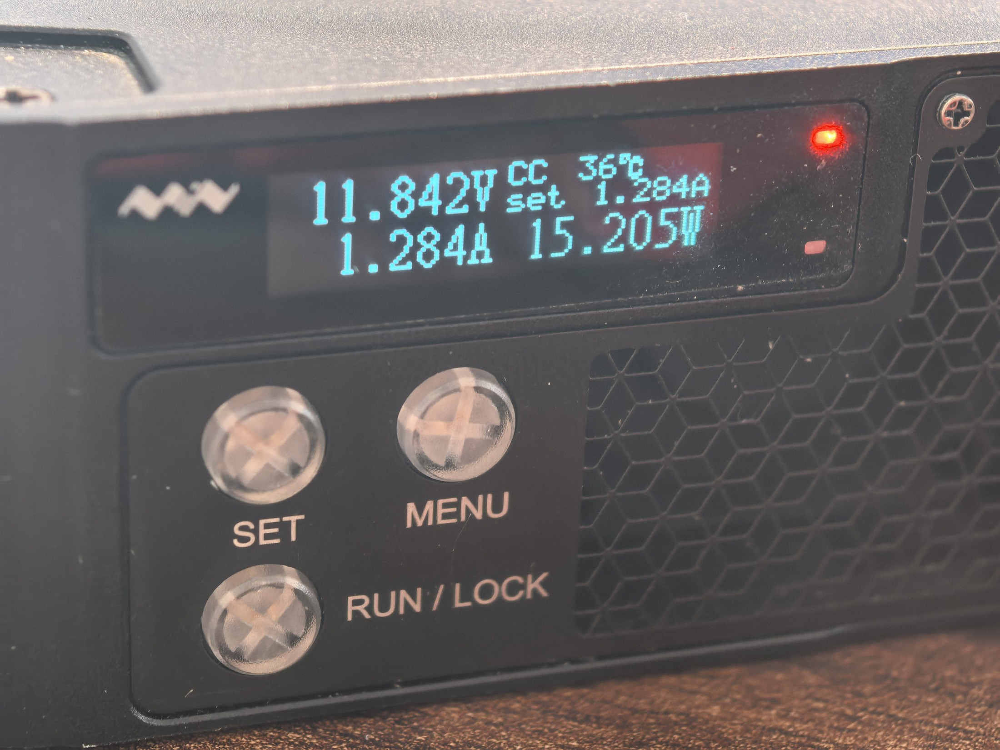

约15W：负载15.205W

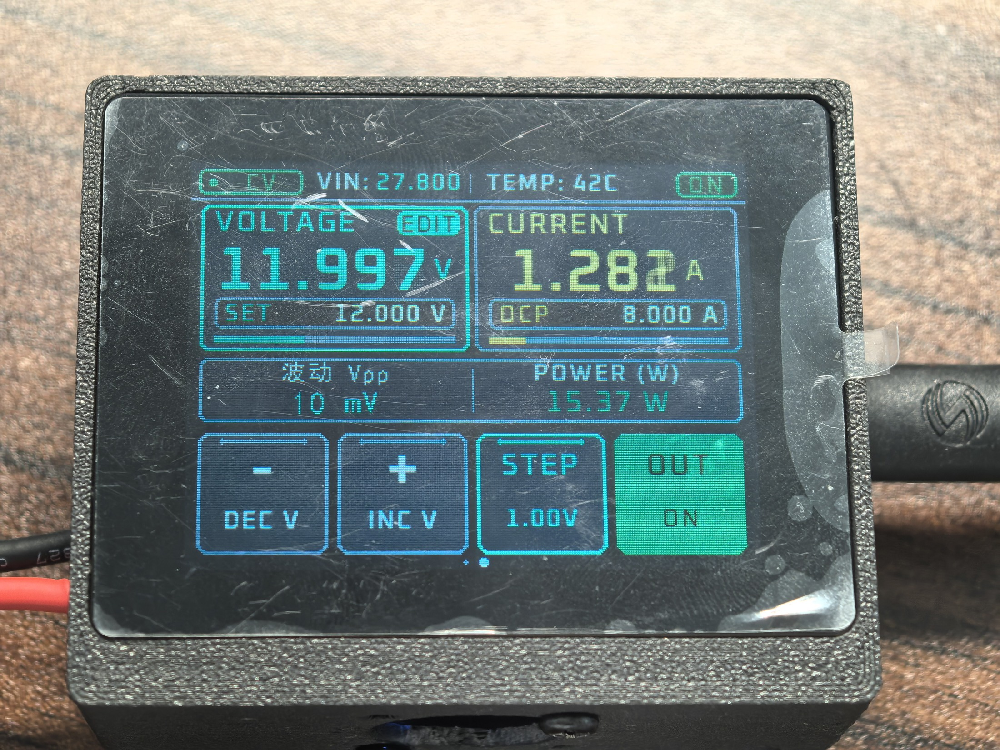

电源15.37W，NTC 42℃

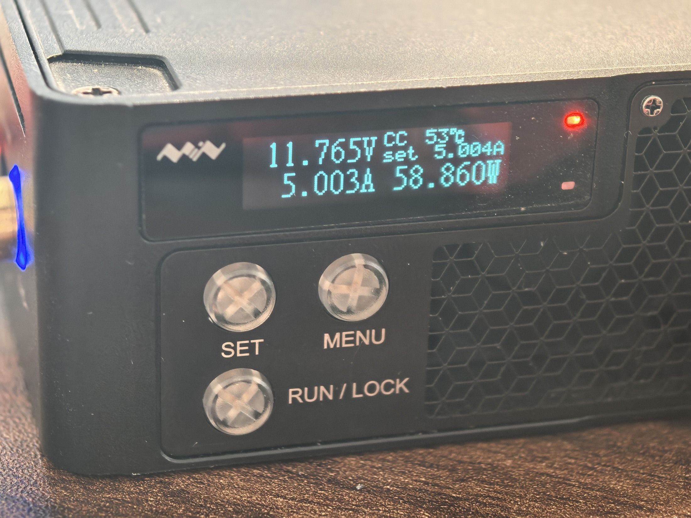

约60W：负载58.860W

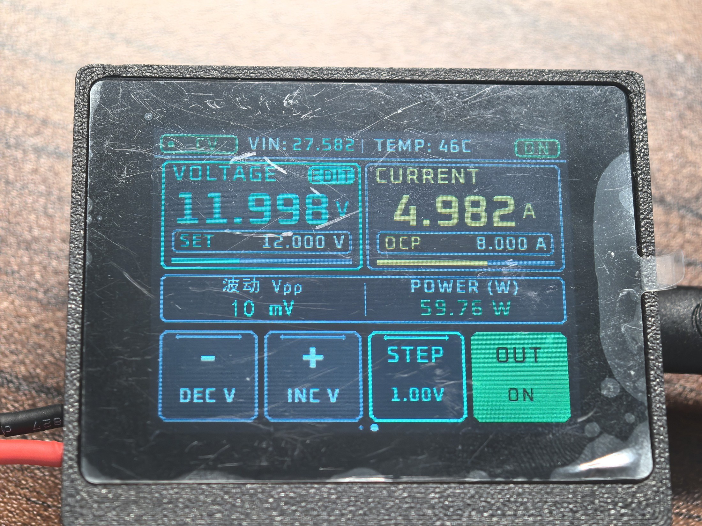

电源59.76W，NTC 46℃

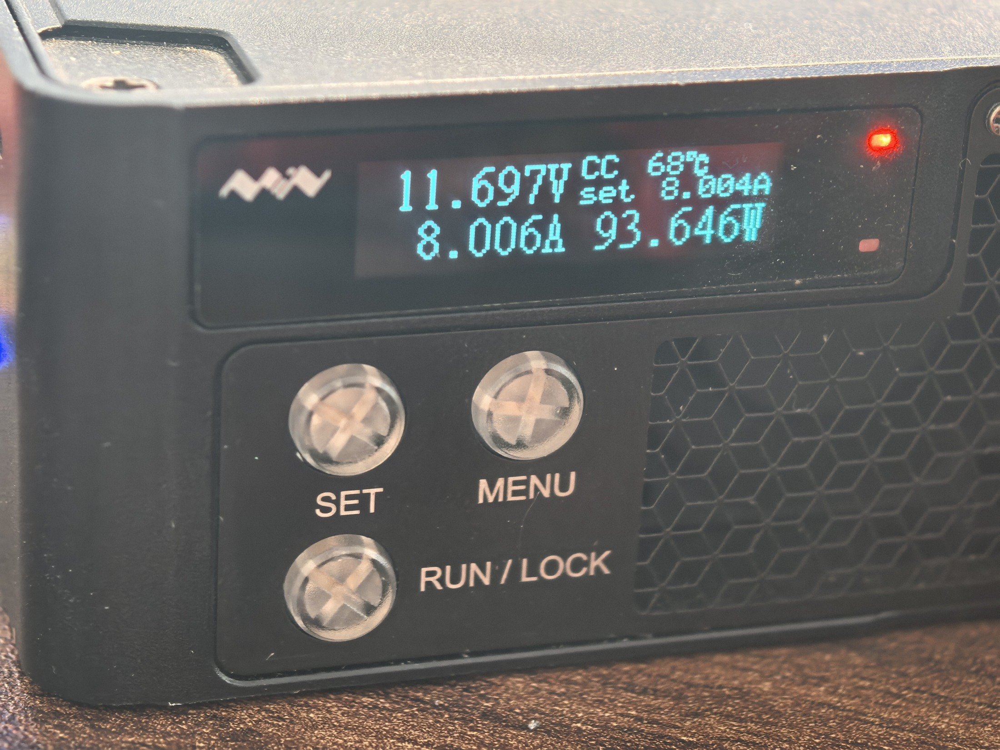

约95W：负载93.646W。

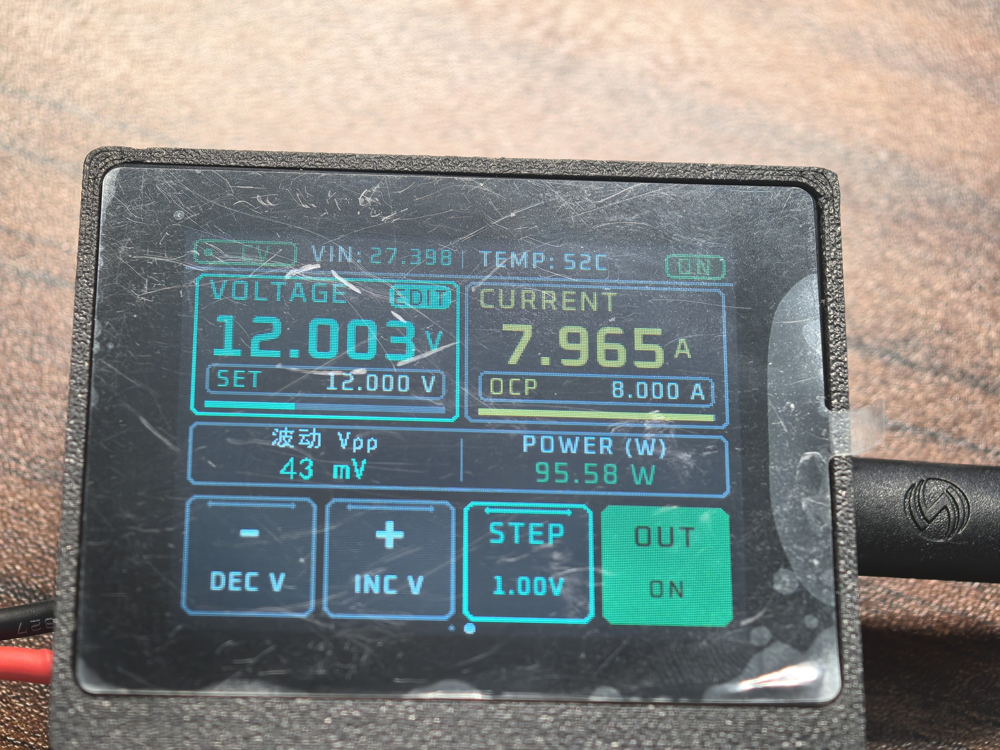

电源95.58W，NTC 52℃

### 约95W连续运行20分钟

**我在约95W负载下连续运行20分钟，板上NTC温度稳定在69℃。**

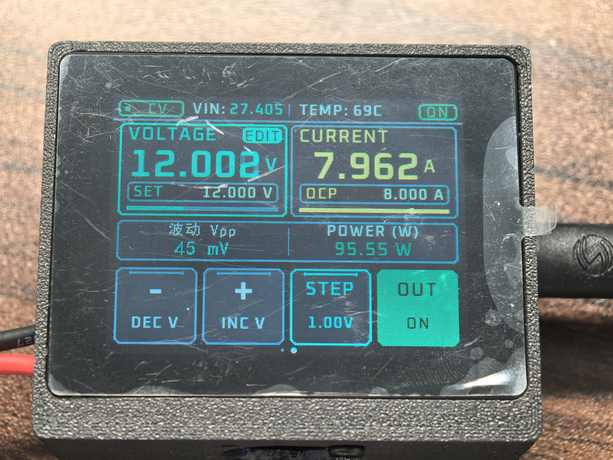

20分钟连续负载记录：输出ON，电源显示95.55W、NTC 69℃。

| 记录项目 | 20分钟记录 |
| --- | --- |
| 设定 / OCP | 12.000V / 8.000A |
| 输入电压 | 27.405V |
| 输出电压 / 电流 | **12.008V / 7.962A** |
| 设备显示功率 | **95.55W** |
| 板上NTC / 板载波动Vpp | **69℃** / 45mV |
| 输出状态 | ON |

## 09 常见问题与资料索引

| 现象 | 优先检查 |
| --- | --- |
| 低压点不能校准 | R316与固件配置是否一致；DAC、LMV321、FB；输出通路 |
| 固定DAC仍漂移 | 参考电压与缓冲输出、输入供电、焊接；不要先改PI参数 |
| 显示有电压但负载掉压 | 输入能力、OCP现场、接插件、线损与校准；检查测量点 |
| 空载触发过流 | 输入/输出电流及故障快照，分流电阻与接线；区分保护电流和显示电流 |
| 电脑无法连接 | CH340驱动、串口占用、数据线；有线/蓝牙端口是否选对 |
| 休眠后负载仍有电 | 正常，屏幕休眠与输出开关独立 |

### 资料索引

| 内容 | 入口 |
| --- | --- |
| 当前开源说明 | 本文 |
| 当前原理图 | [功率部分](../hardware/SCH_XIN_Power功率部分_2026-10-11.pdf)、[控制部分](../hardware/SCH_XIN_Power控制部分_2026-09-24.pdf) |
| 外壳模型 | [上壳](../hardware/enclosure/XIN_Power外壳上.step)、[下壳](../hardware/enclosure/XIN_Power外壳下.step)、[压片](../hardware/enclosure/XIN_Power外壳压片.step) |
| 实物与测试图片 | [图片目录](images/) |
| 待补资料与拍摄计划 | [复刻资料补充清单](复刻资料补充清单.md) |
| 本轮照片索引与读数 | [负载测试记录](负载测试记录.md) |
| 后续持续测试模板 | [95W测试记录模板](95W测试记录模板.md) |

### 代码入口

从[power_config.h](../firmware/current/02_Application/Core/INC/power_config.h)查看范围与阈值，再读[power_control.c](../firmware/current/02_Application/Core/SRC/power_control.c)、[calibration.c](../firmware/current/02_Application/Core/SRC/calibration.c)、[power_monitor.c](../firmware/current/02_Application/Core/SRC/power_monitor.c)、[fan_control.c](../firmware/current/02_Application/Core/SRC/fan_control.c)。屏幕和通信分别查看LCD/UI及debug_console相关文件；上位机入口为[xin_power_qt.py](../firmware/current/05_PC_Tool/xin_power_qt.py)。历史节点放在[history](../history/)，复刻优先采用[当前完整工程](../firmware/current/)。

### 来源与许可

我以LDO75维护本项目。XIN Power在[cyxsnbb666原开源电源](https://oshwhub.com/cyxsnbb666/typec-adjustable-power-supply-wi)基础上开发。固件与上位机沿用仓库GPLv3许可；第三方库和字体保留各自声明。公开中文字体使用OFL授权的思源黑体派生字库。

[GitHub源码](https://github.com/LDO75/XIN_Power)　[当前下载](https://github.com/LDO75/XIN_Power/tree/main/downloads)　[历史版本](https://github.com/LDO75/XIN_Power/tree/main/history)
